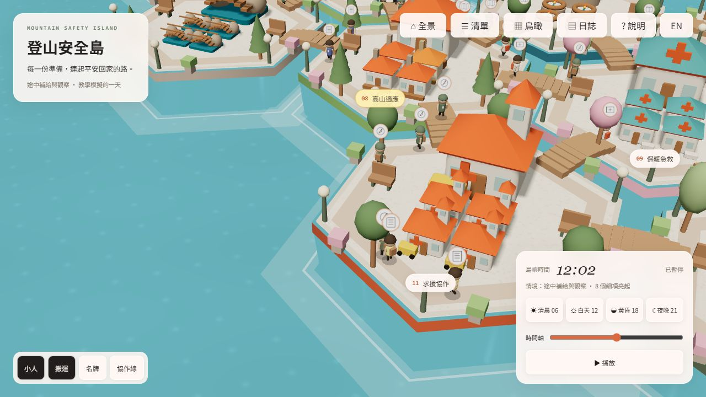

# 登山安全島 Mountain Safety Island

12 座主題島、50 個中英安全細項、8 條示範協作線、48 位小人、日夜與教學日誌。

另有任老、石頭、瓦特、火哥與 Terry 五位黏土特殊人物，可從清單的「島上特別來賓」選取。

五位與一般小人同樣大小，會沿步道和橋樑隨機散步；地圖上另有不附名牌的小叮噹遊走。



## 開始使用

安裝 Node.js（部署工作流程使用 Node 22），在專案目錄執行：

```sh
npm ci
npm run dev
```

開啟終端顯示的網址。OpenSSL 相容參數已內建，不需另設 NODE_OPTIONS。

## 正式版與打包

```sh
npm test
npm run build
npm run test:delivery
npm run preview
```

正式輸出為 dist，預覽開啟 http://localhost:8082/；請透過 HTTP 開啟，避免雙擊 HTML。`?lang=en` 切英文，`?debug=1` 開量測面板。Ctrl+C 停止伺服器。

Windows 執行 `npm run release`，通過檢查後在 releases 產生帶時間的 ZIP，含 site 網站、documentation 文件、第三方授權與 SHA-256 清單；不會上傳或發布。解壓後以 site 為 HTTP 根目錄。

## 文件與維護

- [操作說明](OPERATIONS.md)
- [GitHub Pages 部署](DEPLOYMENT.md)
- [交付紀錄](DELIVERY.md)
- [安全內容查核](SAFETY_REVIEW.md)
- [效能驗收](PERFORMANCE_REPORT.md)
- [進度表](PROGRESS.md)

主題、來源、雙語與情境集中於 src/data.js；初始化在 src/script.js，模型／環境在 model-kit.js／environment.js，互動在 selection.js／explorer.js，小人／日誌在 collaboration.js／journal.js，無障礙／翻譯在 accessibility.js／i18n.js。

本版為 Three.js r126／Webpack 多檔網站，尚未轉成原提示 r160／單一 HTML。全景本機約 60 FPS，近距離全部名牌與線條約 49 FPS；實體手機待測。安全內容為教育摘要，未經外部醫師或救援專家認證，並非即時山況。建置後場景不需 CDN，來源連結需網路。

沿用 Three.js Webpack Starter，保留原致謝 Bruno Simon／Three.js Journey，上游為 designcourse/threejs-webpack-starter。套件既有 UNLICENSED 狀態保留，本次未代原作者授予再散布或商業使用權；交付包另附 Three.js 授權。
